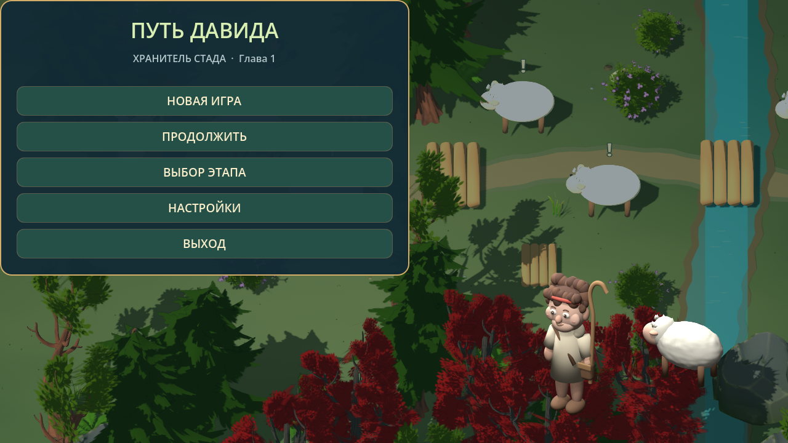
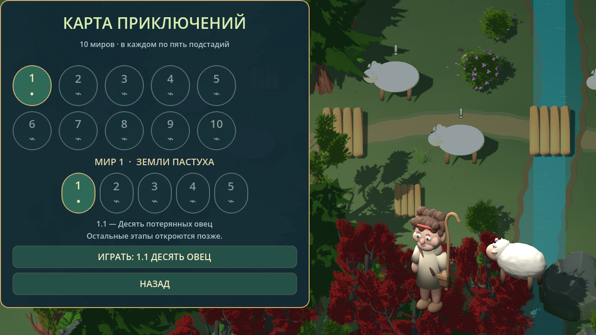
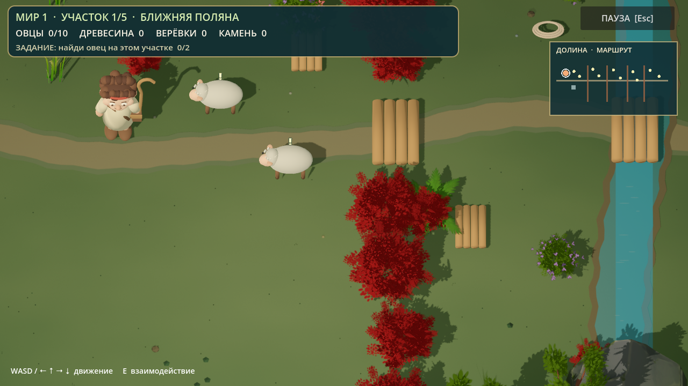
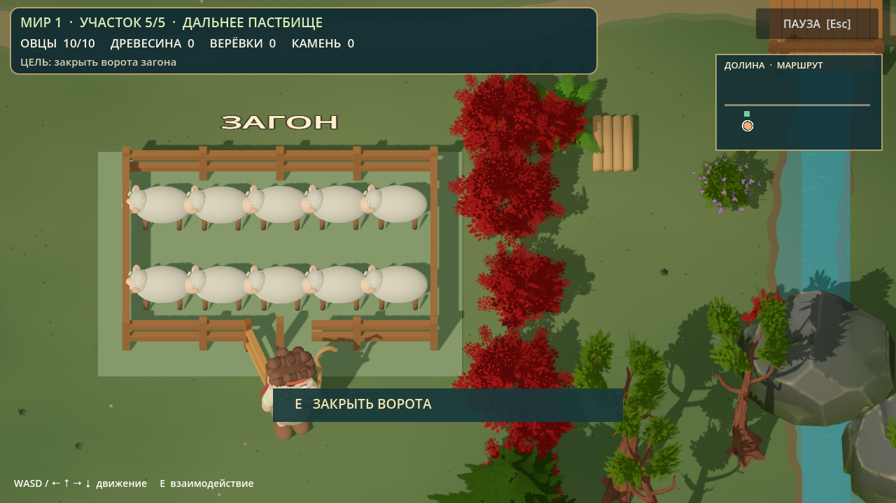
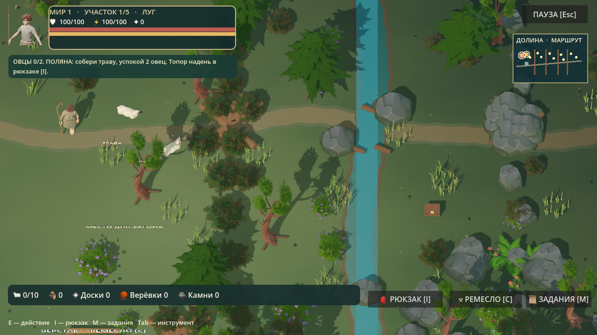
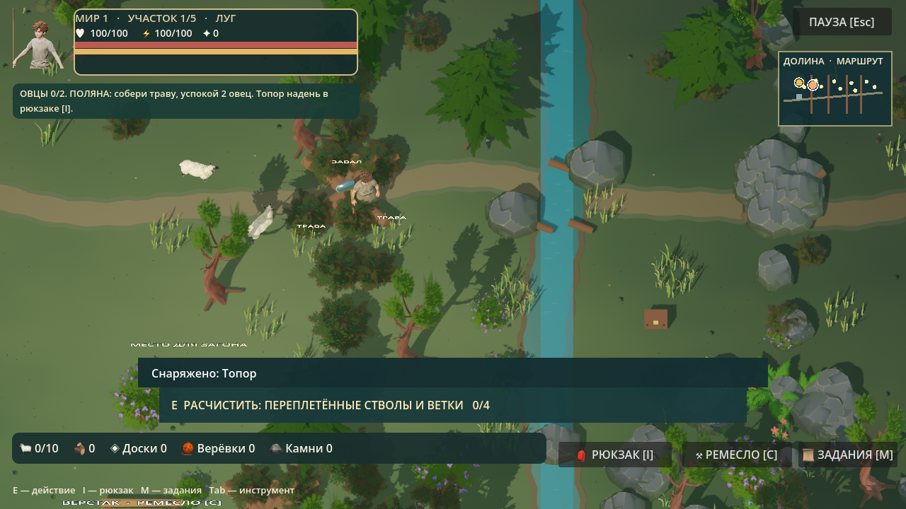
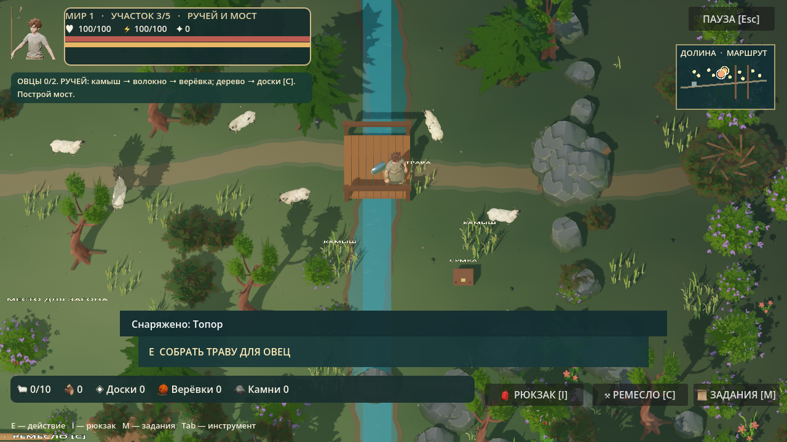
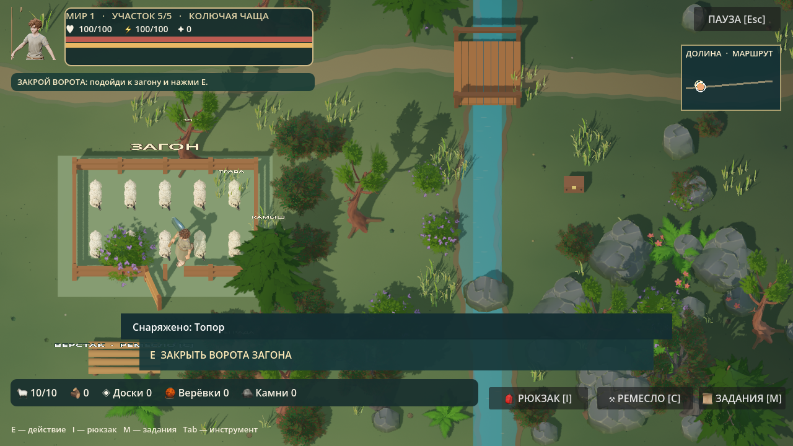
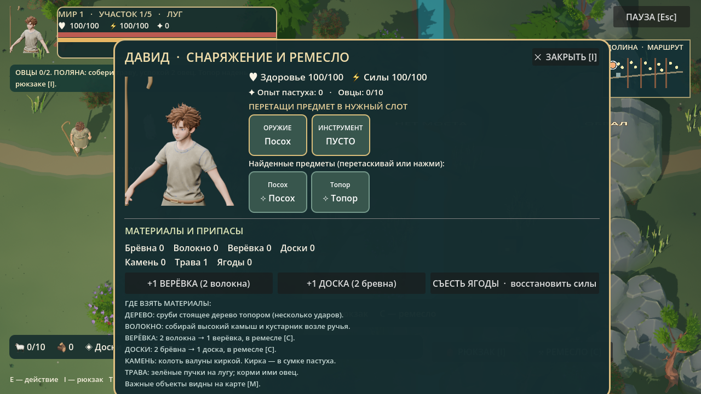
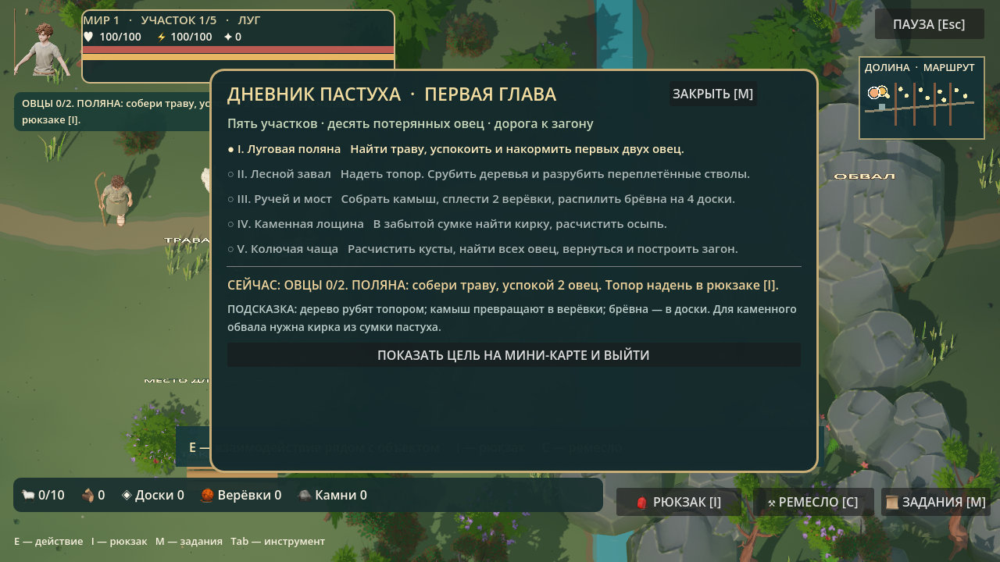

# Путь Давида — четыре скриншота игры
Настоящие кадры из игрового движка Godot.

| Главное меню | Карта приключений |
| --- | --- |
|  |  |

| Игровая долина | Загон с десятью овцами |
| --- | --- |
|  |  |

**Новая версия персонажей:** [Давид, модель Blender](05-new-david-biblical-3d.png) · [Давид и овцы непосредственно в Godot](06-new-david-and-sheep-in-godot.png).

Latest revision: [David without skirt and fitted belt](12-david-tailored-no-skirt.png) | [Actual Godot screenshot](13-david-tailored-in-godot.png)

### Внедрено в Godot 4.7: Давид в тунике (05.11.2026)
- [Давид, овцы и долина: непосредственный 3D-кадр Godot](14-david-biblical-tunic-real-godot-3d.png)
- [Тот же кадр с настоящим игровым интерфейсом](15-david-new-model-in-game-with-hud.png)
- [Давид крупным планом из исходной Blender-модели](16-david-new-tunic-blender-source.png)

## ПЕРЕРАБОТАННАЯ ИГРА 2.0 — 05.11.2026
Скриншоты получены непосредственно из запущенного Godot 4.7.2 на iMac M4.

| Новая карта сверху | Лесной завал |
|---|---|
|  |  |

| Построенный мост | Загон с 10 овцами |
|---|---|
|  |  |

| Инвентарь и инструменты | Дневник заданий |
|---|---|
|  |  |

[Экипированный топор на настоящем 3D-персонаже](26-david-v2-equipped-axe.png)

## Первая стадия: исправленная версия 3 (05.11.2026)
Настоящие кадры из Godot 4.7.2 на iMac M4. Никаких отдельных генераций изображения вместо игры.

- [Обзор карты с новым круглым аватаром](30-david-v3-sharp-overview.png)
- [Оригинальный 3D-рендер в разрешении 2560×1440](31-david-v3-2560x1440-original-render.png)
- [Нарисованный Давид, реальные картинки предметов и слоты снаряжения](32-david-v3-illustrated-inventory.png)
- [Овечка, которую нужно освободить из кустов](33-david-v3-sheep-rescue-trap.png)
- [Рубка дерева: после пятого из десяти ударов](34-david-v3-tree-chopping-five-of-ten.png)
- [Трёхсекундное видео настоящей игры: Давид и идущие овцы](35-david-v3-real-sheep-walk.mp4)

Содержимое: 10 разных ситуаций спасения овец; деревья требуют 10 ударов; лесной завал 18, осыпь 15, колючая чаща 16. В настройках переключается максимальный 3D-рендер 2560×1440 и облегчённый 1920×1080. Сборка установлена в существующую папку новой игры на внешнем диске «Дополнительная память».

## Godot 3.0 — чёткость, овцы, спасение, снаряжение (05.11.2026)
Скриншоты настоящей игры, без генерации отдельных изображений:
- [Чёткая 3D-карта с обновлённым интерфейсом](27-david-v3-sharp-game.png)
- [Первая овца, застрявшая в кустах](28-david-v3-sheep-rescue.png)
- [Настоящая рубка дерева — прогресс 4/10](29-david-v3-ten-hits-wood.png)
- [Рюкзак: рисованный Давид, изображения инструментов и слоты у рук](30-david-v3-hero-inventory.png)
- [Дневник заданий](31-david-v3-quest-journal.png)
- [Десять овец в построенном загоне](32-david-v3-completed-pen.png)

Система: 10 ловушек и спасений, 10–12 ударов на дерево, 14–16 на крупный завал, 3D-частицы щепок, рюкзак с перетаскиванием экипировки, круглый аватар, верхняя строка заданий, выбор графики Standard/High/Ultra, исправленная вертикальная ориентация овец.

## Исправления v4 — овцы, заставка, чёткая графика (05.11.2026)

Все изображения в этом разделе получены из настоящей игры Godot на iMac M4.
- [Настоящая заставка, уже используемая в Godot](27-david-v4-real-title-in-godot.png).
- [Обновлённая игровая долина с PBR травой и землёй](28-david-v4-high-detail-pbr-meadow.png).
- [Овца на земле, скелетная анимация четырёх ног](29-david-v4-real-animated-sheep.png).
- [Видео 4 секунды: ходьба овцы в самом Godot](30-david-v4-true-skeleton-sheep-walking.mp4).

Изменены все десять овец: настоящий скелет Blender (тело + четыре ноги), отдельная циклическая анимация Walk_Quadruped; старое волнообразное искажение всей сетки отключено. Отсутствует искусственное подпрыгивание тела. Корпус вертикален, копыта на уровне земли, повороты по курсу. Панорамная первая заставка построена на реальной 3D-сцене с нативными интерактивными кнопками, никакой неподвижной фотографии поверх экрана. Долина использует CC0-материалы ambientCG Grass004 и Ground068, разрешение внутреннего рендера 2560×1440 и 4×MSAA. Пользовательские художественные референсы предыдущих чатов не были автоматически подменены и требуют отдельной художественной сверки.

## Утверждённая заставка и главное меню (05.11.2026)
Обе выбранные пользователем иллюстрации импортированы в действующий Godot-проект. Картинка с золотым названием и декоративным меню отображается целиком, поверх пяти нарисованных кнопок размещены реальные интерактивные зоны. Чистый пейзаж используется как фон для карты, настроек, вступления и других экранов. Стартовый splash экрана движка тоже использует изображение утверждённого главного меню.
- [Главный экран непосредственно в Godot](27-approved-david-title-screen-in-godot.png)
- [Вторая иллюстрация в экране карты приключений](28-approved-david-valley-art-on-map-screen.png)
